# Site Infrastructure Operations Toolkit

**Three recurring site-infrastructure jobs, each turned into a repeatable, evidence-producing tool:**

| Tool | Question it answers | Evidence it produces |
|---|---|---|
| [`backup/`](backup/restore_verify.py) **Test-restore verification** | *Can we actually get the data back, intact, within RTO and RPO?* | Signed-off restore-test record per dataset |
| [`patching/`](patching/) **Windows patch compliance** | *Is every server and workstation on this cycle's build, and who is past deadline?* | Per-computer compliance with tier deadlines; action list |
| [`switch_onboarding/`](switch_onboarding/onboard.py) **Access switch onboarding** | *Is this new switch request safe, and did it come up correctly?* | Validated config for both sides, change plan, pass/fail post-checks |

> **Provenance.** This is a portfolio reference implementation of operational work I do as a Senior Systems Specialist
> (backup test restores, Windows patch compliance, onboarding switches into the site network). **No employer code, configuration,
> hostnames, IP plans or data are included.** The site `SITE1`, its fabric and every input file are fictional, and the sample
> inventories are generated from seeds.

## Architecture

```mermaid
flowchart TB
    subgraph Backup [Backup test-restore]
      SRC[(Protected data)] -->|backup job| BK[(Backup repository)]
      SRC -->|at backup time| MF[manifest<br/>path · size · SHA-256]
      BK -->|restore sample to isolated target| RST[(Restored copy)]
      MF & RST --> VER[restore_verify<br/>missing · size · hash · extra<br/>RPO · RTO]
      VER --> EV1[[restore-test record<br/>JSON + MD, sign-off]]
    end
    subgraph Patch [Patch compliance]
      HOSTS[(Windows servers<br/>and workstations)] -->|CIM / WinRM, read-only| INV[Get-PatchCompliance.ps1<br/>build.UBR · KBs · boot · reboot pending]
      INV --> CSV[(inventory.csv)]
      BASE[baseline.json<br/>min build per OS · tier grace] --> PR[patch_report.py]
      CSV --> PR --> EV2[[compliance report<br/>+ action list]]
    end
    subgraph Switch [Switch onboarding]
      REQ[new-switch.json] --> VAL[validate<br/>naming · IPAM · ports · VLANs · uplinks]
      FAB[fabric.json<br/>site source of truth] --> VAL
      VAL --> RND[render<br/>access config · DS1/DS2 changes · plan]
      RND --> CHG{{change window}}
      CHG --> SHOW[show output] --> PC[postcheck<br/>LACP · trunk · STP root · NTP · version]
      PC --> EV3[[pass/fail record]]
    end
```



## Quick start

```bash
python3 -m unittest discover -s tests -v                                    # 16 tests

python3 -m backup.restore_verify demo                                       # end-to-end with injected corruption
python3 -m patching.patch_report --inventory data/synthetic/patch_inventory.csv --as-of 2026-11-01
python3 -m switch_onboarding.onboard plan --request switch_onboarding/samples/new-switch.json
python3 -m switch_onboarding.onboard postcheck --request switch_onboarding/samples/new-switch.json \
        --show switch_onboarding/samples/postcheck-good.txt
```

Example outputs:

```text
demo injected 1 corrupted and 1 missing file; detected exactly those: True
FAIL (expected FAIL). Evidence: out/evidence/restore-test_demo-share_<date>.md

113 computers, 93.8% compliant or in grace; {'COMPLIANT': 91, 'NON-COMPLIANT': 3, 'IN GRACE': 15, 'UNKNOWN': 3, 'UNSUPPORTED': 1}

SITE1-AS-3F-01: valid; wrote config, distribution changes and change plan to out/onboarding/
PASS  Po16 up and in use (SU)                    SU
PASS  Po16 has 2 bundled members                 Te1/1/1, Te2/1/1
PASS  trunk allows the fabric VLANs              10,20,30,40,50,99
PASS  this switch is NOT spanning-tree root      root is upstream
PASS  NTP synchronised                           synchronized
PASS  software 17.12.4                           17.12.4
```

Everything runs on the Python 3.9+ standard library. `Get-PatchCompliance.ps1` runs on Windows PowerShell 5.1 or PowerShell 7
against real hosts. CI checks its syntax only.

## Documentation

| Document | Contents |
|---|---|
| [Backup and restore testing](docs/backup-restore-testing.md) | 3-2-1-1-0 design, test schedule by tier, isolated restore targets, what "pass" means |
| [Patch management](docs/patch-management.md) | Cycle, rings, tier deadlines, maintenance windows, exceptions, reporting |
| [Switch onboarding](docs/switch-onboarding.md) | Site fabric model, request → validate → render → change → post-check, rollback |
| [Design decisions](docs/design-decisions.md) | Why each tool works the way it does |

## Skills shown

Backup and disaster recovery (RPO/RTO, restore testing, integrity verification) · Windows Server patch management (CIM/WinRM, build/UBR, reboot detection) · Cisco campus switching (LACP, 802.1X/MAB, DHCP snooping, DAI, Rapid-PVST+ root guard, AAA/TACACS+/RADIUS, SNMPv3) · change management · configuration as code · Python · PowerShell · test automation
