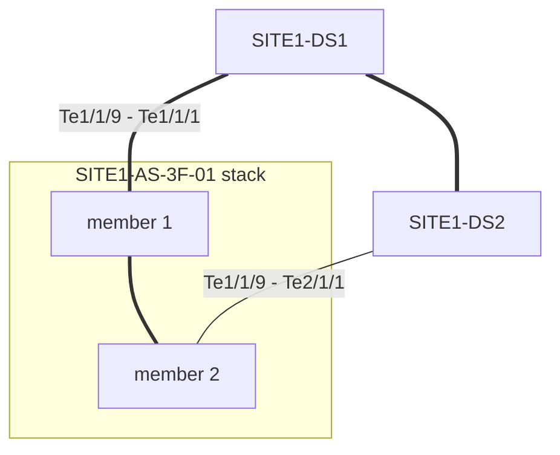

# Switch Onboarding

## Site fabric model (`fabric.json`)

The single source of truth for what an access switch must fit into:

| Section | Contents |
|---|---|
| `models` | Supported access models, port counts, uplink naming, software family |
| `target_software` | Approved IOS XE release per family |
| `management` | MGMT VLAN, subnet, gateway, reserved and used addresses |
| `vlans` | Every VLAN the site carries |
| `port_profiles` | user (802.1X/MAB + voice), printer, camera, AP trunk, unused (parking VLAN, shut) |
| `distribution` | DS1/DS2 free ports and used port-channel numbers |
| `services` | AAA (TACACS+ for admins, RADIUS for 802.1X), NTP, syslog, SNMPv3, DHCP snooping VLANs |

## Topology

Po16 is one LACP port-channel across the distribution pair (StackWise Virtual) and across both stack members. Either a distribution switch or a stack
member can fail without the floor losing connectivity. The distribution side has **root guard**, so a new switch can never become spanning-tree root.

## Workflow

| Step | Command / action | Fails if |
|---|---|---|
| 1 Request | Fill `new-switch.json` (hostname, model, stack size, mgmt IP, port-channel, uplinks, port map) | n/a |
| 2 Validate | `onboard validate` | Bad hostname, IP outside MGMT or in use, port-channel taken, uplink port not free, both uplinks to one DS, uplinks on one member, unknown VLAN, ports unassigned or assigned twice |
| 3 Render | `onboard plan` → access config, DS1 and DS2 snippets, change plan | n/a |
| 4 Bench | Stack, upgrade to target, load config with vault secrets filled | `show run \| include {{` returns anything |
| 5 Change window | Apply DS snippets, rack, cable, power on | n/a |
| 6 Post-check | Collect show output, `onboard postcheck` | Po not SU, member not bundled, wrong trunk VLANs, **local STP root**, NTP not synced, wrong software |
| 7 Close | IPAM and inventory set to "active", add `mgmt_ip` to `fabric.json` `in_use` via pull request | n/a |

## Security baseline in the rendered config

- AAA: TACACS+ for admin login with local fallback, command accounting; RADIUS for 802.1X/MAB.
- Every unused port in the parking VLAN and shut down.
- BPDU guard on all edge ports; errdisable recovery after 5 minutes.
- DHCP snooping and Dynamic ARP Inspection on user, voice, printer, camera and AP VLANs; uplinks trusted.
- SSH v2 only, VTY ACL, 10-minute timeouts, login banner, SNMPv3 authPriv only.
- No secrets in the repository: `{{RADIUS_KEY}}`, `{{TACACS_KEY}}`, `{{SNMP_AUTH}}`, `{{SNMP_PRIV}}` and `{{LOCAL_ADMIN_HASH}}` are filled from the vault at deploy time.

## Rollback

Shut Po16 and its member ports on DS1 and DS2, then remove the added config. The change only adds new interfaces, so the rest of the site isn't affected.
